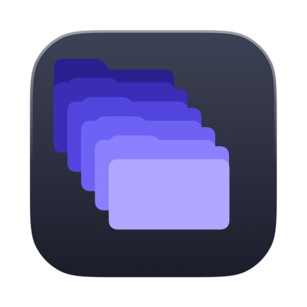
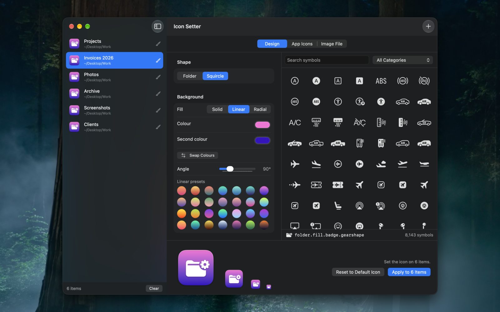
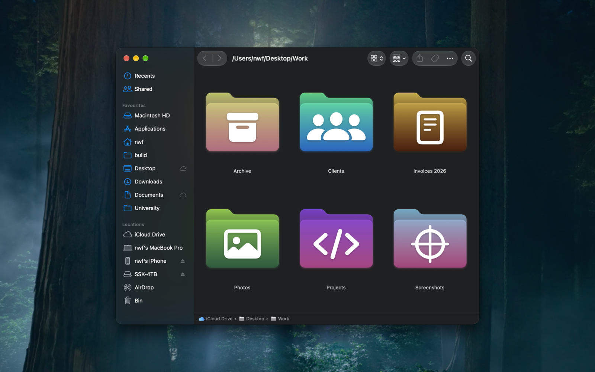

<p align="center">
  
</p>

<h1 align="center">Icon Setter</h1>

A small native macOS app for giving folders (and files) custom icons.

<p align="center">
  
</p>

## Features

- **Design** an icon from a colour or gradient plus any SF Symbol. Two shapes:
  the system folder recoloured with the symbol on its front, or an app-icon style
  squircle. Solid, linear (with angle) and radial fills, each with its own
  palette of 28 presets: flat hues, earth tones and neutrals for solid; bold
  cross-hue blends and lit-to-near-black ramps for linear; glowing cores falling
  to deep rims for radial. Swatches paint the way the current fill style will.
  Symbol colour / size / weight / opacity controls.
- **App Icons**: browse and search the icons of every app installed on the Mac
  and apply one to a folder. "Other App…" picks a bundle anywhere on disk.
- **Image File**: drop, choose or paste a PNG, JPEG, HEIC, TIFF, GIF, SVG, PDF or
  ICNS. Non-square images are centred on a transparent square canvas.
- Searchable SF Symbols (read live from the OS's own catalog, with the same
  keywords and categories as the SF Symbols app) and searchable app list.
- Apply to many folders and files at once. Drop them in the sidebar, use the +
  button (⌘O), drop them on the Dock icon, or right-click in Finder and choose
  **Services › Set Custom Icon…**.
- **Reset to Default Icon** strips a custom icon again.
- Icons are written with every size Finder uses (16 px to 1024 px), each drawn
  natively rather than downsampled.

<p align="center">
  
</p>

## Install

```sh
brew tap n14395/tap
brew install --cask icon-setter
```

Or download the `.dmg` from [Releases](../../releases) and drag IconSetter to
Applications. Requires macOS 15 or later.

## Building

`build.sh` follows the same contract as the other apps under `~/build`:

```sh
./build.sh                 # build/IconSetter.app (Release)
./build.sh --dmg           # …and build/IconSetter.dmg
./build.sh --sign          # …Developer ID sign, notarize and staple
./build.sh --version 1.1   # set the version in project.yml (committed) before building
./build.sh --publish v1.1  # tag, push and cut a GitHub release from build/IconSetter.dmg
./build.sh --sparkle       # a direct-download build with the Sparkle updater built in
./build.sh --help
```

The Xcode project is generated from `project.yml` with
[xcodegen](https://github.com/yonaskolb/XcodeGen). `build.sh` regenerates it
whenever `project.yml` is newer than the project; after adding or removing
source files run `xcodegen generate` yourself, then `open IconSetter.xcodeproj`
to work in Xcode. The version lives in `MARKETING_VERSION` in `project.yml`.

Requires macOS 15 or later. The default build is signed to run locally only and
is not sandboxed (it needs to write the icon resource into whatever folder you
point it at).

### The Finder service

macOS registers the Services menu entry the first time the app is launched (or
when it is registered with LaunchServices). If **Set Custom Icon…** doesn't show
up under Services in Finder's context menu straight away, launch the app once,
then relaunch Finder or log out and back in.

## Layout

```
project.yml                      xcodegen project definition (bundle id com.n14395.IconSetter)
IconSetter/App/                  App entry point, delegate (Services + open-files), AppModel state
IconSetter/Models/               GeneratedIconSpec (the design), TargetItem
IconSetter/Rendering/            IconArtworkView (the design, drawn at any size) and IconRenderer
IconSetter/Services/             SFSymbolCatalog, AppCatalog, IconApplier
IconSetter/Views/                SwiftUI screens
Design/AppIcon.svg               The app's own icon (source of truth for the asset catalog)
Scripts/make-app-icon.swift      Rasterises Design/AppIcon.svg into the asset catalog
build.sh                         Build, package, sign and publish (see above)
```

The app icon is `Design/AppIcon.svg` (a stack of five folders in tints of the
app's indigo, on graphite). To regenerate the asset catalog after editing it:

```sh
swiftc -swift-version 6 -O -parse-as-library -o /tmp/make-app-icon Scripts/make-app-icon.swift
/tmp/make-app-icon Design/AppIcon.svg IconSetter/Resources/Assets.xcassets/AppIcon.appiconset
```

AppKit renders the SVG itself, so nothing beyond the toolchain is needed.

## License

Licensed under the [Apache License, Version 2.0](LICENSE).
Third-party attribution is in [NOTICE](NOTICE).
